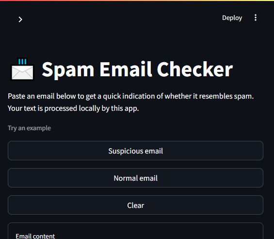
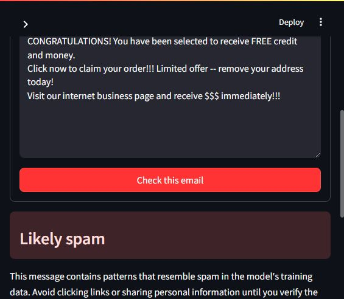
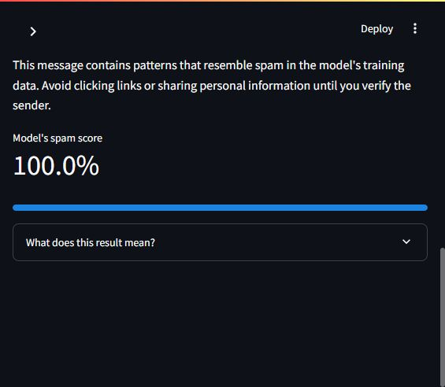

# Spam Email Detector

[](https://www.python.org/)
[](https://streamlit.io/)
[](https://numpy.org/)
[](https://pandas.pydata.org/)
[](https://scikit-learn.org/)
[](https://joblib.readthedocs.io/)
[](https://docs.pytest.org/)
[](https://github.com/forva2025/Spam_Email_Detector/actions/workflows/tests.yml)
[](https://spamemaildetector-mhbu4yj9c32zrn6ohxsvbm.streamlit.app/)
[](LICENSE)

A machine-learning project that classifies pasted email content as **likely
spam** or **likely not spam**. It fairly benchmarks Naive Bayes, Logistic
Regression, Random Forest, and SVM on the UCI Spambase dataset, records the
measured experiment artifacts, and presents predictions and evaluation charts
through Streamlit.

## Live demo

Try the deployed model in your browser:

**[Open the Spam Email Detector on Streamlit Community Cloud](https://spamemaildetector-mhbu4yj9c32zrn6ohxsvbm.streamlit.app/)**

> This project is an educational demonstration. It should be used as a second
> opinion, not as a replacement for a mail provider's security filters.

## Table of contents

- [Live demo](#live-demo)
- [Features](#features)
- [Application screenshots](#application-screenshots)
- [How it works](#how-it-works)
- [Technology stack](#technology-stack)
- [Dataset](#dataset)
- [Project structure](#project-structure)
- [Getting started](#getting-started)
- [Using the application](#using-the-application)
- [Training the model](#training-the-model)
- [Automated testing](#automated-testing)
- [Model performance](#model-performance)
- [Feature engineering](#feature-engineering)
- [Limitations](#limitations)
- [Troubleshooting](#troubleshooting)
- [Possible improvements](#possible-improvements)
- [License](#license)

## Features

- Paste an email's subject and body into an easy-to-use browser interface.
- Receive a clear **likely spam** or **likely not spam** result.
- Select any of four trained classifiers for the primary result.
- Compare all four predictions and spam scores side by side.
- Explore measured accuracy, precision, recall, F1, cross-validated F1, and
  confusion matrices in the Model Comparison Dashboard.
- View the model's spam score as a percentage and progress bar.
- Load built-in normal and suspicious example messages.
- Convert ordinary email text into the model's 57 required numeric features
  automatically.
- Validate short or empty input before attempting a prediction.
- Process pasted text locally; the application does not send it to an external
  prediction API.
- Retrain the model from the included dataset with a reproducible train/test
  split.
- Re-run a five-fold benchmark that records CSV/JSON metrics and versioned
  joblib artifacts.

## Application screenshots

### Email checker

The landing screen lets a user paste an email or load one of the built-in
examples.



### Spam classification

After checking a suspicious message, the interface displays a clear result and
plain-language safety guidance.



### Spam score

The result also includes the model's spam score and an expandable explanation
of what the score means.



## How it works

```text
Pasted email text
        |
        v
Word, character, and capital-run feature extraction
        |
        v
57 numeric Spambase features in the trained column order
        |
        v
Selected benchmark model
        |
        v
Classification and spam score displayed in Streamlit
```

The training workflow and application workflow share the same feature schema.
Before prediction, the application verifies that the generated columns match
the feature names stored in the trained model.

## Technology stack

| Technology | Version | Purpose |
| --- | ---: | --- |
| Python | 3.13 tested | Application and model-training language |
| Streamlit | 1.45.1 | Interactive web user interface |
| NumPy | 2.2.6 | Numeric arrays used by the saved estimator |
| pandas | 2.3.0 | Dataset loading and model-ready tabular features |
| scikit-learn | 1.7.0 | Four classifiers, pipelines, splitting, and evaluation |
| joblib | 1.5.1 | Saving and loading the trained model |
| Altair | 5.5.0 | Chart rendering used by Streamlit |
| Regular expressions | Python standard library | Token and uppercase-run extraction |
| Git | Any recent version | Source control |

The dependency versions are pinned in `requirements.txt` to make the local
environment reproducible.

## Dataset

The project uses the [UCI Spambase dataset](https://archive.ics.uci.edu/dataset/94/spambase).
The local `spam.csv` contains:

- **4,601 email records**
- **57 numeric input features**
- **1 binary target column** named `spam`
- **2,788 non-spam records** (`spam = 0`)
- **1,813 spam records** (`spam = 1`)

The features describe how frequently selected words and characters occur and
how uppercase-letter sequences are distributed. The dataset does not contain
the original raw email messages.

## Project structure

```text
Spam_Email_Detector/
|-- .github/workflows/     # GitHub Actions continuous-integration workflow
|-- app.py                 # Email checker and model-comparison dashboard
|-- artifacts/             # Recorded CSV metrics and detailed JSON report
|-- assets/                # Screenshots used by this README
|-- benchmark.py           # Fair four-model training/evaluation pipeline
|-- feature_extractor.py   # Converts raw text into 57 Spambase-style features
|-- models/                # Four benchmark model artifacts
|-- tests/                 # Unit, model, and Streamlit integration tests
|-- spam.py                # Legacy Naive Bayes-only training entry point
|-- spam.csv               # Numeric training dataset
|-- spam_model.joblib      # Model artifact generated by spam.py
|-- requirements-dev.txt   # Test and development dependencies
|-- requirements.txt       # Pinned Python dependencies
|-- README.md              # Project documentation
`-- LICENSE                # MIT license
```

## Getting started

### Prerequisites

- Python 3.10 or newer
- `pip`
- A terminal such as PowerShell, Command Prompt, or Bash

### 1. Clone or download the project

```bash
git clone https://github.com/forva2025/Spam_Email_Detector.git
cd Spam_Email_Detector
```

If the project is already on your computer, open a terminal in its directory
instead.

### 2. Create a virtual environment

On Windows PowerShell:

```powershell
python -m venv .venv
.\.venv\Scripts\Activate.ps1
```

On macOS or Linux:

```bash
python3 -m venv .venv
source .venv/bin/activate
```

### 3. Install the dependencies

```bash
python -m pip install --upgrade pip
python -m pip install -r requirements.txt
```

### 4. Run the benchmark

Run this step to reproduce the comparison, model files, and metric artifacts:

```bash
python benchmark.py
```

For backward compatibility, `python spam.py` still retrains only the original
Naive Bayes model and updates both of its artifact paths.

### 5. Start the web application

```bash
python -m streamlit run app.py
```

Streamlit will print a local address, normally
`http://localhost:8501`. Open that address in a browser. Stop the server with
`Ctrl+C` in the terminal.

## Using the application

1. Open **Email checker** in the sidebar.
2. Choose a prediction model.
3. Paste the subject and body of an email.
4. Select **Check this email**.
5. Review the selected result and the side-by-side comparison.

Open **Model comparison** to switch evaluation metrics, inspect each confusion
matrix, and compare a separate message across all four models.

The **Suspicious email** and **Normal email** buttons fill the text box with
examples so the interface can be tested immediately. The **Clear** button
removes the current text.

The spam score comes from the model's `predict_proba` output. It is useful for
comparison, but it is not a calibrated real-world probability or a guarantee
that a message is safe.

## Training the model

`benchmark.py` loads the same checked-in dataset once, creates one 80/20
stratified split (`random_state=42`), and gives every algorithm the identical
3,680 training rows and 921 untouched test rows. Five-fold stratified
cross-validation is performed on the training split only. Logistic Regression
and SVM use `StandardScaler` inside their pipelines so scaling is learned
separately in every fold; Naive Bayes and Random Forest use the original
non-negative features.

After cross-validation, each estimator is fitted on the complete training
split and evaluated once on the shared test split. The script writes:

- `models/*.joblib`: four prediction-ready estimators;
- `artifacts/model_comparison.csv`: tabular hold-out and CV metrics;
- `artifacts/benchmark_report.json`: dataset checksum, configuration,
  parameters, fold scores, and confusion matrices;
- `spam_model.joblib`: the original Naive Bayes path retained for existing
  deployments.

Reproduce the recorded run with:

```bash
python benchmark.py
```

Do not load joblib model files from unknown or untrusted sources. Deserializing
an untrusted artifact can execute malicious code.

## Automated testing

The project includes 19 pytest tests across four layers:

- `tests/test_feature_extractor.py` verifies the 57-column schema, empty input,
  word and character percentages, and uppercase-run calculations.
- `tests/test_model.py` verifies the saved artifact, feature compatibility,
  valid probabilities, and stable predictions for known examples.
- `tests/test_app.py` uses Streamlit's headless `AppTest` framework to verify
  startup, validation, dashboard rendering, and prediction comparisons.
- `tests/test_benchmark.py` verifies the shared deterministic split, model
  configuration, and consistency between the recorded CSV and JSON artifacts.

Install the development dependencies and run the suite from the project root:

```bash
python -m pip install -r requirements-dev.txt
python -m pytest tests -v
```

The workflow in `.github/workflows/tests.yml` runs the same suite on Python
3.13 after every push and pull request. The status badge at the top of this
README links to the latest GitHub Actions run.

## Model performance

These are the actual results produced from the checked-in dataset with
scikit-learn 1.7.0. Values are from the single shared hold-out set; CV F1 is
the mean of five folds on the training split.

| Model | Accuracy | Precision | Recall | F1 | CV F1 mean ± std |
| --- | ---: | ---: | ---: | ---: | ---: |
| Naive Bayes | 77.63% | 71.99% | 70.80% | 71.39% | 72.50% ± 2.69% |
| Logistic Regression | 92.94% | 92.09% | 89.81% | 90.93% | 90.00% ± 1.37% |
| Random Forest | **94.57%** | **95.10%** | **90.91%** | **92.96%** | **93.70% ± 0.81%** |
| SVM | 92.73% | 92.77% | 88.43% | 90.55% | 91.17% ± 0.94% |

Held-out confusion matrices are recorded as `[[TN, FP], [FN, TP]]`:

| Model | TN | FP | FN | TP |
| --- | ---: | ---: | ---: | ---: |
| Naive Bayes | 458 | 100 | 106 | 257 |
| Logistic Regression | 530 | 28 | 37 | 326 |
| Random Forest | 541 | 17 | 33 | 330 |
| SVM | 533 | 25 | 42 | 321 |

Random Forest led this run on hold-out F1 and cross-validated F1. Model choice
should still account for false positives, missed spam, inference behavior, and
the raw-text limitation below—not accuracy alone.

## Feature engineering

The trained model expects numeric values rather than raw text. For the
Streamlit interface, `feature_extractor.py` converts pasted text into the same
57-column schema:

- **48 word-frequency features:** percentages for terms such as `free`,
  `money`, `credit`, `business`, `meeting`, and `project`.
- **6 character-frequency features:** percentages for `;`, `(`, `[`, `!`, `$`,
  and `#`.
- **3 uppercase-run features:** average uppercase run length, longest uppercase
  run, and total uppercase characters.

Words are matched case-insensitively. The generated DataFrame is ordered using
the exact feature list expected by the model. The UI refuses to predict if the
model's stored feature names and the extractor's columns differ.

Because the original Spambase dataset contains precomputed features rather
than its source messages, the app's raw-text conversion is an approximation of
the dataset creator's preprocessing. This can affect real-world predictions.

## Limitations

- The training data was collected in the 1990s and may not represent modern
  spam language, phishing techniques, or legitimate email patterns.
- The model does not inspect sender reputation, email headers, URLs, domains,
  attachments, images, HTML structure, or malware.
- The model recognizes only a fixed set of words and characters.
- The raw-text feature extraction approximates the preprocessing used to build
  the original numeric dataset.
- The displayed model scores are not calibrated probabilities and may be
  overconfident.
- The benchmark includes cross-validation and one held-out test split, but it
  is not a production evaluation on modern email traffic.
- Non-English messages and specialized business language may perform poorly.
- Pasted messages remain in the Streamlit process while the page is active;
  avoid pasting sensitive information into deployments you do not control.

## Troubleshooting

### `spam_model.joblib was not found`

Run the benchmark from the project directory:

```bash
python benchmark.py
```

Then restart Streamlit.

### `No module named streamlit`

Install the project dependencies in the active Python environment:

```bash
python -m pip install -r requirements.txt
```

### The app opens with a model/feature mismatch error

The saved model was probably trained with a different column schema. Confirm
that `spam.csv`, `benchmark.py`, and `feature_extractor.py` belong to the same
version of the project, then rerun the benchmark.

### PowerShell blocks virtual-environment activation

You can run the environment's Python directly without activating it:

```powershell
.\.venv\Scripts\python.exe -m pip install -r requirements.txt
.\.venv\Scripts\python.exe -m streamlit run app.py
```

## Possible improvements

- Add threshold tuning, ROC-AUC/PR-AUC, and probability calibration.
- Add nested cross-validation or a separate final validation dataset before
  tuning model hyperparameters.
- Train directly on a modern raw-email dataset using TF-IDF or transformer
  embeddings.
- Add URL, sender-domain, HTML, and attachment metadata features.
- Expand the tests with malformed dataset schemas and artifact corruption.
- Package the application in Docker and add deployment health checks.
- Add user feedback collection for incorrectly classified messages without
  storing private email content by default.

## License

This project's source code is available under the [MIT License](LICENSE).
The dataset has its own terms and attribution requirements; consult the UCI
dataset page before redistributing it.
